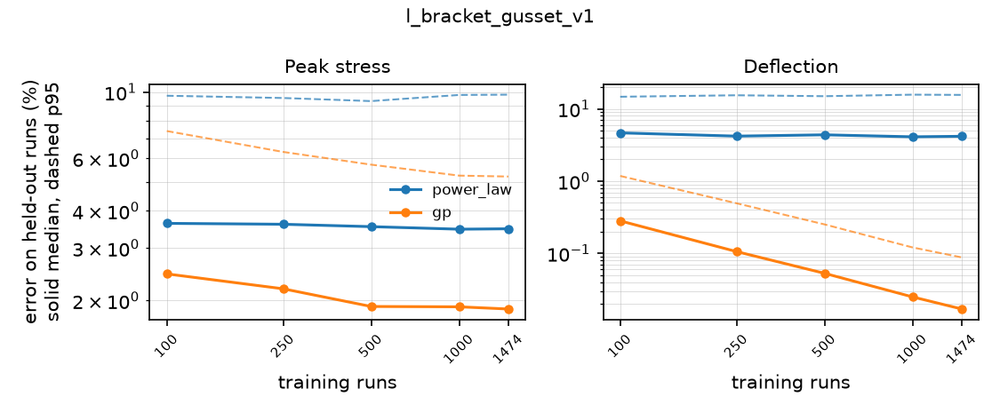
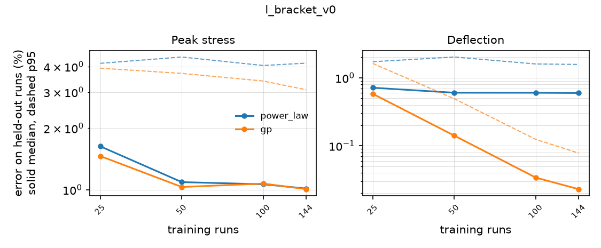

# Role 2 models: the predictors that shortlist designs

The models learn from Role 1's CalculiX datasets, one per bracket family, and answer `predict(spec) -> Prediction`, the interface of the contracts' fake. PyDiscovery uses them through `App(predictor=...)`. Both predictors now take any family's inputs: the dimensions plus Poisson's ratio, in log space, with load and stiffness scaled exactly (stress with force, deflection with force over E). Mass is closed form.

| Family | Dataset | Rows | Inputs | Mesh |
| --- | --- | --- | --- | --- |
| `l_bracket_v0` | `data/processed/formal_v0/` | 200 | 5 dimensions and Poisson's ratio | v0 uniform rule, 1 to 2 mm |
| `l_bracket_gusset_v1` | `data/processed/formal_v1_l_bracket_gusset_v1/` | 2,048 (Sobol) | 8 dimensions and Poisson's ratio | curvature rule, HXT, medium level |
| `t01_double_hole_v1` to `t10_offset_planform_v1` | `data/processed/formal_multifamily_v1/` | 80 each (60 Latin hypercube, 20 paired variants) | 6 to 9 dimensions and Poisson's ratio | Role 1's representative mesh, stress within 3% and deflection within 1% of the next level |

| Model | File | How it works | Needs |
| --- | --- | --- | --- |
| `power_law_v0`, `power_law_v1`, `power_law_t01_double_hole_v1` to `power_law_t10_offset_planform_v1` | `src/models/power_law.py` | log(stress) and log(deflection) are straight lines in the log of the inputs; coefficients and calibrated band widths are built in for v0 and v1, and read from `template_fits.json` for the templates | nothing extra |
| `gp_powerlaw_v1` (v0), `gp_powerlaw_l_bracket_gusset_v1` | `src/models/gp.py` | the power law as the mean, plus a Gaussian process with one length scale per input on what it misses; retrains from the family's `model_dataset.csv` at start-up (1 s for v0, about 4 minutes for v1) and applies the benchmarked band scale | scikit-learn |
| AutoGluon (comparison only) | `src/models/compare.py` | `TabularPredictor` in quantile mode on the same inputs, `medium_quality`, 60 s per fit | `autogluon.tabular` |

`src/models/datasets.py` reads each family's `model_dataset.csv` with the inputs from its `summary.json`. `python -m src.models.benchmark --family <key>` runs the protocol below and writes `docs/model_data/<key>_benchmark.json`. `src/models/multifamily.py` reads Role 1's multi-family table and writes the template fits (`--fit`) and their comparison (`--benchmark`); see "The ten templates" below.

## Protocol

A seeded 20% test split (seed 0); 10% of the rest is held back for calibration and the remainder trains. Every model is fitted on the training rows and scored on the test rows as absolute percent error on the original scale (median and p95) plus the share of test rows inside its 90% band. Calibration then rescales each band so 90% of the calibration rows fall inside it, and the test score is repeated. v1 calibrates on its 164-row slice; v0's slice would be 16 rows, too few for a 90% quantile, so v0 calibrates on 5-fold out-of-fold residuals of the 160 non-test rows. The power law refits on every subset; the GP refits with 3 optimizer restarts on v0 and 1 on v1 (a full v1 fit is 4 to 6 minutes per restart).

## v1: the gusseted bracket on 2,048 runs

Train 1,474, calibration 164, test 410.

| Model | Stress median | Stress p95 | Deflection median | Deflection p95 | 90% coverage (raw -> calibrated) |
| --- | --- | --- | --- | --- | --- |
| `power_law` | 3.48% | 9.82% | 4.18% | 15.62% | stress 90% -> 89%, deflection 90% -> 90% |
| `gp` | 1.87% | 5.22% | 0.02% | 0.09% | stress 90% -> 90%, deflection 98% -> 94% |
| `autogluon` | 2.30% | 7.55% | 2.75% | 8.34% | stress 92% -> 88%, deflection 97% -> 92% |

The median-only baseline sits at 39% on stress and 56% on deflection.

- **Poisson's ratio** earns its place for deflection: without it the GP's deflection median is 0.42%, with it 0.02%. Stress does not move (1.91% against 1.87%), and the power law barely changes either way, because the Poisson effect is not log-linear. Both shipped models keep it as an input.
- **Stress is noisier than deflection.** The GP's fitted white-noise level on v1 stress is about 2.6% in log space, so roughly 2% of the stress error is in the labels themselves (the peak sits on the 2 mm junction fillet, where the medium mesh was within 1.5% of the fine one) and no model on these inputs will get far below the GP's 1.9%. Deflection is a smooth global quantity and the GP fits it to 0.02%.
- **Learning curve:** the GP's stress error flattens at 500 rows (1.9%); its deflection error keeps falling through 1,474 (0.28% at 100 rows, 0.02% at the full set). The power law is flat from 100 rows, so the log-linear form is the limit, not the data. AutoGluon lands between the two.
- **Mass:** the closed-form volume (legs, inside fillet, hole, gusset triangle minus its overlap with the fillet fill, and the 2 mm junction fillet along its eight edges) is within 0.012% of Role 1's mesh volumes on all 2,048 rows, so `volume_v1_mm3` is used as is; only the four tip blends are left out.

**Verdict.** PyDiscovery should use the GP for v1: it halves the power law's stress error, is two hundred times better on deflection, and its calibrated bands hold 90% and 94% of the test rows. The power law (`power_law_v1`, built in) is the fallback where scikit-learn is missing or the 4-minute start-up is unwelcome; its bands are honest (89% and 90%), its medians are not tight. AutoGluon stays in the comparison only.

## v0 on the same protocol

Train 144, calibration by out-of-fold residuals on 160, test 40 (so coverage moves in 2.5% steps).

| Model | Stress median | Stress p95 | Deflection median | Deflection p95 | 90% coverage (raw -> calibrated) |
| --- | --- | --- | --- | --- | --- |
| `power_law` | 1.01% | 4.15% | 0.60% | 1.57% | stress 88% -> 88%, deflection 95% -> 95% |
| `gp` | 1.01% | 3.08% | 0.02% | 0.08% | stress 80% -> 82%, deflection 98% -> 80% |
| `autogluon` | 2.07% | 9.01% | 5.24% | 14.43% | stress 90% -> 78%, deflection 78% -> 75% |

Poisson's ratio does the same for v0 deflection (GP 0.55% without, 0.02% with). The shipped v0 power law keeps its 200-run coefficients and fixed band; it stays the v0 default because its coverage sits inside 85 to 95% on the test rows, while the GP's calibrated bands land at 82% and 80% there (three and four rows of forty short of 90%). The GP remains the better v0 model on p95 stress and on deflection. `python -m src.models.compare` still reproduces the earlier 25-to-150-run curves on `runs.csv`.

## The v0 stress bias, measured

The v1 work found that v0's uniform mesh under-read the gusseted baseline's peak stress by 12% (240.7 against 273.7 MPa). `python -m src.models.v0_mesh_bias` re-solved 48 v0 designs (a seeded spread of the formal plan, seed 0) with the v0 geometry and the v1 production mesh rule (max = min(3, t/2), min = max/4, curvature sizing at 16 per circle, HXT, high-order optimization), through Role 1's family registry and without touching the dataset. The table is `docs/model_data/v0_mesh_bias.csv`.

| Ratio, v1 mesh over v0 label | Median | Mean | Spread (std) | Range |
| --- | --- | --- | --- | --- |
| Peak stress | 1.000 | 1.019 | 5.6% | 0.954 to 1.164 |
| Deflection | 0.9994 | 0.9996 | 0.07% | 0.9986 to 1.0013 |

The stress ratio is not a constant: it tracks the fillet radius (correlation -0.71). Designs with a 2 to 3 mm fillet read 15% higher on the v1 mesh (median 1.151 over seven designs), 3 to 4 mm about 3.5% higher, and everything above 4 mm sits within 5% of its label, mostly a little below (0.98 to 0.99). Forty-one of the 48 ratios are within 5% of 1; the other seven, all small fillets, are above 1.05. Deflection is unchanged. Because the spread is over the 5% rule, **no correction is applied** to the v0 models; `V0_STRESS_CORRECTION` in `power_law.py` is `None` and the code path that would apply one is tested but idle. What this means for v0: stress labels, and predictions, lean optimistic for fillets under about 4 mm, by up to 16% at the 2 mm end, and are sound above that. A fillet-dependent correction would model the mesh error rather than the part, so the clean fix is Role 1 re-solving the 200 v0 runs on the v1 rule (the 48 took 15 minutes on three workers). This is Can's finding to act on; his data is unchanged.

## The ten templates on Role 1's 1,000-row multi-family table

Role 1's second dataset (`docs/role1_multifamily_handoff.md`) keeps the 200 v0 runs and adds 80 CalculiX cases for each of ten bracket templates: double hole (T01), single slot (T02), twin slot (T03), rounded window (T04), side notches (T05), tapered (T06), stepped (T07), twin gusset (T08), perforated gusset (T09) and offset planform (T10). Every row carries 20 shared CAD descriptors (envelope, thickness, volume, surface area, centroid, inertia tensor, support and load face geometry) meant for one model across families, and the design manifest keeps each template's own dimensions. Role 1's split holds out the whole T07 family (80 rows), with 736 training and 184 validation rows over the other ten families.

Two candidates were fitted on the training split and scored on the validation split (absolute percent error, median and p90). The shared models also score T07, a family they never saw; the per-template power laws cannot.

| Model | Trained on | Stress median / p90 | Deflection median / p90 | T07 stress | T07 deflection |
| --- | --- | --- | --- | --- | --- |
| shared ridge, 20 CAD features | 736 | 8.4% / 20.6% | 2.49% / 9.80% | 20.2% / 29.5% | 3.41% / 10.72% |
| shared GP, 20 CAD features (Matern, minutes to fit) | 736 | 6.6% / 18.1% | 1.22% / 4.19% | 20.5% / 30.6% | 2.69% / 4.63% |
| power law, T01 double hole | 64 | 3.0% / 3.8% | 0.65% / 1.29% | | |
| power law, T02 single slot | 64 | 0.8% / 2.7% | 0.82% / 1.21% | | |
| power law, T03 twin slot | 64 | 1.8% / 4.0% | 0.66% / 1.31% | | |
| power law, T04 rounded window | 64 | 4.2% / 6.3% | 0.78% / 1.65% | | |
| power law, T05 side notches | 64 | 2.2% / 6.2% | 1.05% / 2.35% | | |
| power law, T06 tapered | 64 | 1.6% / 3.3% | 0.83% / 1.87% | | |
| power law, T07 stepped | held out | | | | |
| power law, T08 twin gusset | 64 | 2.0% / 4.0% | 2.23% / 7.87% | | |
| power law, T09 perforated gusset | 64 | 1.6% / 3.9% | 1.58% / 3.12% | | |
| power law, T10 offset planform | 64 | 0.4% / 1.5% | 0.58% / 1.97% | | |

**Verdict.** The per-template power laws ship. The shared models answer a different question, whether 20 CAD descriptors can carry stress across shapes, and the answer on this data is not well enough for a shortlist: 6 to 8% median stress error on families they trained on and 20% on the unseen T07, because the peak stress sits at a feature (a slot end, a notch mouth, a rib junction) that the descriptors do not locate. Deflection, a global quantity, they carry to 1 to 3%. A template's own dimensions fix that feature, and a log-linear fit on them reaches 0.4 to 4.2% median stress error from 64 rows, in line with the v1 power law's 3.5% from 1,474. Each shipped fit uses all 80 rows of its template with a 5-fold held-out sigma and no band rescaling, as the v0 fit does (`src/models/template_fits.json`, written by `python -m src.models.multifamily --fit`; the validation numbers above come from the train-only refit the same command prints). T07 is fitted on its 80 rows like the others; its hold-out role was for the shared models only.

**Mass** is closed form for every template (`src/models/template_families.py`), derived from Role 1's builders: through-thickness cuts (holes, slots, the rounded window, the half-round notches with their four 0.8 mm mouth roundings), the taper's cubic Bezier integrating to 0.28 of trim times length per side, the step and offset roundings cancelling in convex and concave pairs, and the ribs as in v1 with their 2 mm junction fillets. Against Role 1's CAD volumes on all 800 rows: exact for T01 to T04, T06, T07 and T10; 0.003% for T05; 0.018% at most for the ribbed T08 and T09 (the rib tip blends, as in v1).

**Rules.** The clearance checks inside Role 1's builders (3 mm from openings to the fillet, the free end, the sides and each other; rib reach, spacing and side clearance; hole and notch clearances) are ported by name, and all 800 built rows pass them, so the emulator refuses a design the builder would refuse before anything is solved.

## Model card

- **Intended use:** shortlisting designs of the twelve families for a solver to verify. The shortlist is judged at the pessimistic end of each model's 90% band, so the band matters as much as the median. Not a replacement for the solver check.
- **Training data:** v0, 200 CalculiX runs, Latin hypercube over five dimensions and Poisson's ratio, uniform 1 to 2 mm mesh. v1, 2,048 runs, scrambled Sobol over eight dimensions and Poisson's ratio, converged curvature mesh. The templates, 80 runs each (60 Latin hypercube and 20 paired mass-reduction variants) on Role 1's representative mesh. All at 500 N along -Y with E = 200,000 MPa; other loads and stiffnesses are scaled exactly, yield and density come from the part.
- **Metrics:** absolute percent error on the test split (median and p95) and calibrated 90% band coverage, as in the tables above. Coverage near 90% means the band is honest. The templates report median and p90 on Role 1's validation split.
- **Defaults:** v0, the built-in power law; v1, the GP (power law as the fallback); the templates, their power law (there is no template GP, and `App(predictor="gp")` falls back to the power law for them). v0 and v1 pass the gate of 85 to 95% test coverage for both targets; the template bands are 5-fold sigmas without a calibration slice, so their coverage is not benchmarked.
- **Limits:** outside the sampled ranges the models extrapolate (`in_training_range` flags these designs; the GP's band widens there, the power law's does not). v0 peak stress leans optimistic for fillets under 4 mm (above). v1 stress carries about 2% label noise at the junction fillet. The templates have 80 rows each, so a p90 stress error of 4 to 8% is normal and T04's rounded window is the loosest fit. One load direction, one material in training. Candidates get Poisson's ratio from the part, or 0.30 when none is given.
- **How to retrain:** `python -m src.models.benchmark --family <key> --print-constants`, paste the printed block into `power_law.py` (v1) and the GP band scales into `gp.py`, and update the tables here. The GP retrains itself at start-up from the family's `model_dataset.csv`. The v0 built-ins are unchanged since the 200-run fit. The templates: `python -m src.models.multifamily --fit` rewrites `template_fits.json`, `--benchmark` prints the table above.
- **Not covered yet:** a benchmark against the team's Ansys solve; v0 labels re-solved on the v1 mesh rule.
