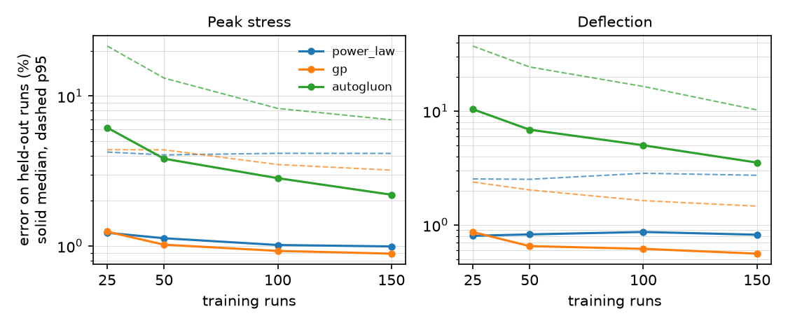

# Role 2 models: the predictors that shortlist designs

All models learn from Role 1's CalculiX runs (`runs.csv`, the contract's Data to Model hand-off). The two shipped predictors answer `predict(spec) -> Prediction`, the same interface as the fake, and PyDiscovery uses them through `App(predictor=...)`. AutoGluon is in the comparison only; it is not wired into the emulator.

| Model | File | How it works | Needs |
| --- | --- | --- | --- |
| `power_law_v0` (default) | `src/models/power_law.py` | log(stress) and log(deflection) are straight lines in the log of the five dimensions; coefficients are built in | nothing extra |
| `gp_powerlaw_v1` | `src/models/gp.py` | the power law as the mean, plus a Gaussian process on what it misses; retrains from `runs.csv` at start-up (about 1 s) | scikit-learn and `runs.csv` |
| AutoGluon (comparison only) | `src/models/compare.py` | `TabularPredictor` in quantile mode on the same log inputs and log targets, `medium_quality`, 60 s per fit | `autogluon.tabular` |

## Model comparison

`python -m src.models.compare` holds out 50 runs (seeded), then trains every model on 25, 50, 100 and 150 of the other 150 runs, three random draws per size, and scores each fit on the same 50 held-out runs. The power law is refitted on each subset rather than using its built-in coefficients. Raw records go to `data/processed/model_comparison/results.json` (gitignored).

| Model (n = 150) | Stress median | Stress p95 | Deflection median | Deflection p95 | 90% band coverage |
| --- | --- | --- | --- | --- | --- |
| `power_law` | 0.99% | 4.14% | 0.82% | 2.73% | 90% stress, 90% deflection |
| `gp` | 0.89% | 3.20% | 0.56% | 1.46% | 80% stress, 86% deflection |
| `autogluon` | 2.20% | 6.94% | 3.53% | 10.24% | 92% stress, 98% deflection |

Errors are absolute percent errors on the original scale, averaged over the three draws. Coverage is the share of held-out runs inside the model's 90% band. A median-only baseline is in `results.json` for reference and sits around 37% on stress and 58% on deflection.



The GP is the most accurate at every size, with the refitted power law close behind: both are near 1% median error from 25 runs on, because the log-linear form already carries most of the physics, and the power law is flat from 50 runs. AutoGluon has to learn that form from scratch, so at 150 runs it is 2 to 4 times worse on the medians and still improving steeply; more data would help it most, while the GP's gains after 100 runs are small (deflection p95 from 1.64% to 1.46%). On this held-out set the GP's band is a little narrow (80 to 86% inside a nominal 90% band) where the power law's is on target, so a design that only just passes under the GP deserves the solver check the pipeline already gives it.

**Status:** AutoGluon itself was used, not the stand-in: `autogluon.tabular` 1.6.3 on Python 3.12, `medium_quality`, 60 s limit per fit (fits took 12 to 60 s each). CatBoost and FastAI were not installed, so its ensembles drew on LightGBM, random forest, extra trees, k-nearest neighbours and the Torch network. At n = 150 the three draws are the same 150 runs, so that column has no spread. Run on 2026-11-16.

## Accuracy on all 200 runs (5-fold cross-validation)

The earlier check of the two shipped predictors, reproducible with `python -m src.models.gp`:

| | Stress median | Stress p95 | Deflection median | Deflection p95 | 90% band coverage |
| --- | --- | --- | --- | --- | --- |
| Power law | 1.02% | 3.46% | 0.81% | 2.70% | fixed width |
| GP | 0.78% | 3.16% | 0.56% | 1.34% | 89% stress, 91% deflection |

Mass needs no model: the closed-form volume matches Role 1's meshes to 1e-15.

## Getting the training data

Until Role 1's branch is merged, copy the runs file from it. The folder is gitignored, so it won't be committed:

```
git fetch origin
python -c "import subprocess, pathlib; p = pathlib.Path('data/processed/formal_v0/runs.csv'); p.parent.mkdir(parents=True, exist_ok=True); p.write_bytes(subprocess.run(['git', 'show', 'origin/Jin(role--data):data/processed/formal_v0/runs.csv'], check=True, capture_output=True).stdout)"
pip install -r src/models/requirements.txt
```

`autogluon.tabular` in that file is optional and large. Without it, `compare.py` says so and uses scikit-learn's `HistGradientBoostingRegressor` with quantile loss as the tree-model stand-in.

## Model card

- **Intended use:** shortlisting L-bracket v0 designs (Role 1's family) for a solver to verify. The shortlist is judged at the pessimistic end of each model's 90% band, so the band matters as much as the median. Not a replacement for the solver check.
- **Training data:** 200 CalculiX runs from Role 1 (`runs.csv`, schema in `contracts/`), uniform over the five dimensions, all at 500 N along -Y with E = 200,000 MPa and one mesh rule. Other loads and stiffnesses are scaled exactly (stress with force, deflection with force over E); yield and density come from the part.
- **Metrics:** absolute percent error on held-out runs (median and p95) and 90% band coverage, as in the tables above. Coverage near 90% means the band is honest; well above means it is too wide and the shortlist too cautious.
- **Limits:** outside the sampled ranges the models extrapolate (`in_training_range` flags these designs; the GP's band widens there, the power law's does not). Peak stress leans optimistic because the labels come from Role 1's production mesh: a 30% finer mesh read peak stress 2 to 7% higher on three rows. One load direction, one material in training, five dimensions only.
- **How to retrain:** copy a new `runs.csv` as above. The GP retrains itself at start-up. For the power law, run `fit_power_law(path)` and paste the returned `COEF` and `SIGMA_LOG` into `power_law.py`. Rerun `python -m src.models.compare` and `python -m src.models.gp` and update the tables here.
- **Not covered yet:** a benchmark against the team's Ansys solve, and learning curves beyond 150 runs (Role 1 would need to generate more).
